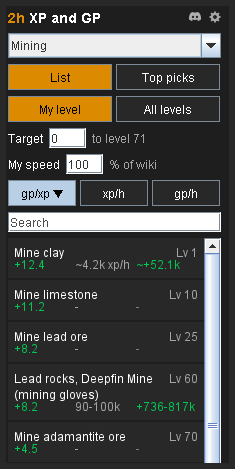
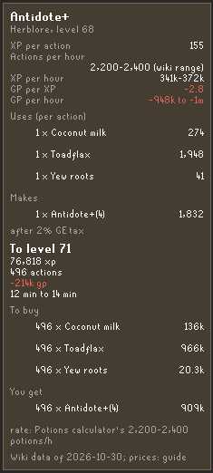

- Right-click a skill: the cheapest, fastest and most profitable ways to train it. 
- 2,659 wiki-sourced methods in 24 skills: gp/xp, xp/h, gp/h and cost to your goal.

<table width="100%">
<tr>
<td valign="top">

## What it shows

- **List.** Every method for the skill you pick: level, gp per xp, xp per hour and gp per hour, priced from the Grand Exchange. Spending is red with a minus, earning is green with a plus.
- **Top picks.** Up to three methods each for fastest xp, best gp per hour and cheapest per xp, plus the ones the wiki suggests, for what you can do now.
- **Hover card.** Items in and out, xp per action, actions per hour, and the cost and time to your next level or a target level, with what to buy.
- **Healing.** For Hitpoints, a list of 286 foods and potions by gp per hp.

## Quick guide

1. **Open.** Right-click a skill in the Skills tab and choose "GP/XP", or open the sidebar and pick a skill.
2. **Pick a view.** List, Top picks, or Healing (Hitpoints only).
3. **Pick levels.** "My level" lists what you can do now. "All levels" adds the rest, greyed.
4. **Sort.** Click gp/xp, xp/h or gp/h. Click the lit box again to reverse.
5. **Search.** Type part of a method's name. Click the x to clear.
6. **Set a target.** Type a level in the Target box. 0 means your next level.
7. **Set "My speed".** From 10 to 100 percent of the wiki's rates.
8. **Read a method.** Hover a row to see its card. Right-click it to open its wiki page.
9. **Settings.** Click the settings icon to hide profit methods, show other level bands, take off the 2% Grand Exchange tax, change the sort, or pick the price source.

## Good to know

- **Prices.** Grand Exchange guide prices by default. Pick "Live trade prices" in the settings menu to buy at the latest buy price and sell at the latest sell price.
- **Rates.** Where the wiki gives a range, "about", "up to" or "at least", the row shows it that way. A method with no stated rate shows a dash.
- **Cost not stated.** Where the wiki does not say what a method costs, the row shows a dash, not "free".
- **Privacy.** Nothing leaves your machine unless you pick "Live trade prices". Then the plugin asks only for the wiki's public price list, nothing about you.
- **Sources.** Method figures come from the OSRS Wiki (CC BY-NC-SA). Each row keeps its wiki link.
- **Something wrong?** Tell us in the 2hBuilds Discord - the link is in the settings menu.

</td>
<td width="28"></td>
<td align="right" valign="top" width="235">

 

</td>
</tr>
</table>

 

<table width="100%">
<tr><td colspan="3"></td></tr>
<tr>
<td valign="top">

## The hover card

- **Facts.** XP per action, actions per hour, xp per hour, gp per xp and gp per hour.
- **Items.** What the method uses and makes, with quantities and prices.
- **To your target.** xp, actions, cost and time to your next level or target level, plus what to buy and what you get.
- **Note.** The wiki's note for the method, and the date of the data.

</td>
<td width="28"></td>
<td align="right" valign="top" width="235">

 

</td>
</tr>
</table>

---

<strong>Found a bug or have an idea?</strong> Join the <a href="https://discord.gg/nsam4CfWzf">2hBuilds Discord</a>.

Method data from the <a href="https://oldschool.runescape.wiki">OSRS Wiki</a>, CC BY-NC-SA. Want every figure and setting explained? Read the <a href="https://github.com/2hBuilds/gp-per-xp/blob/main/DETAILS.md">full details</a>.
